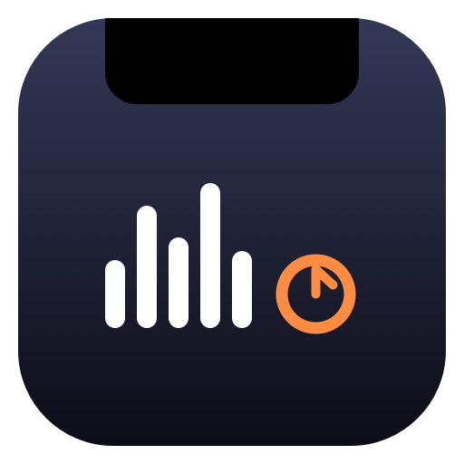
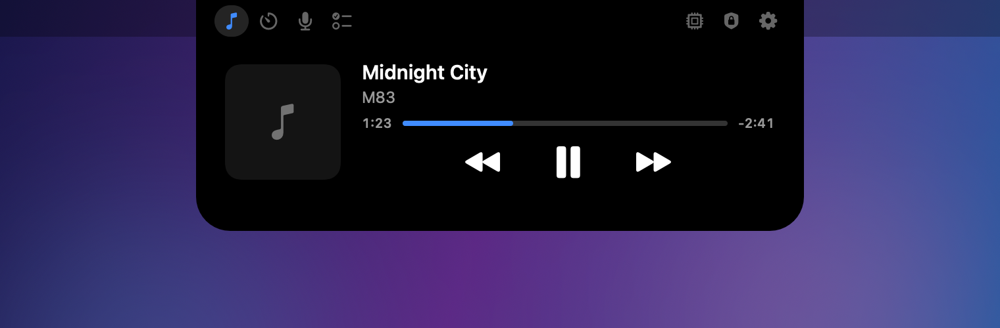
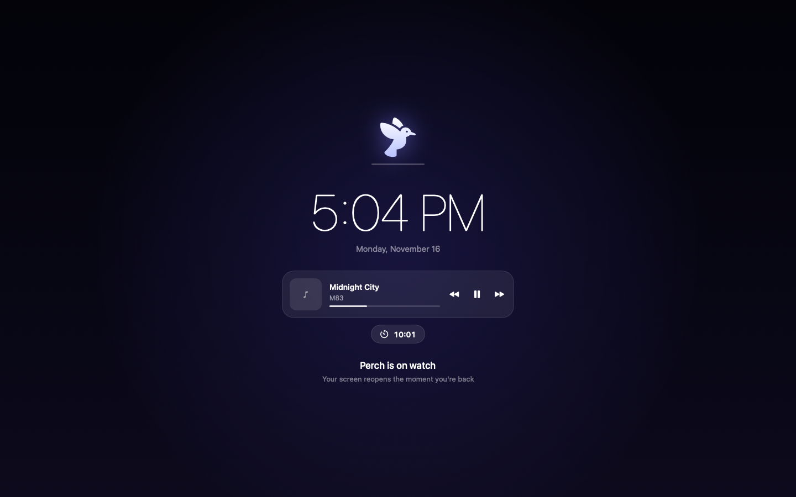
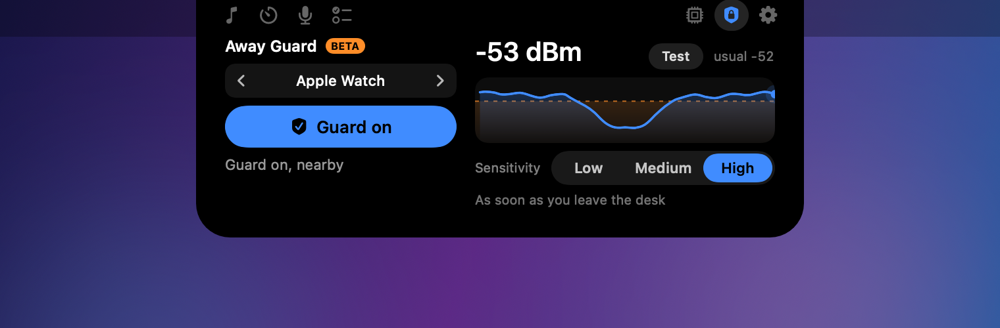
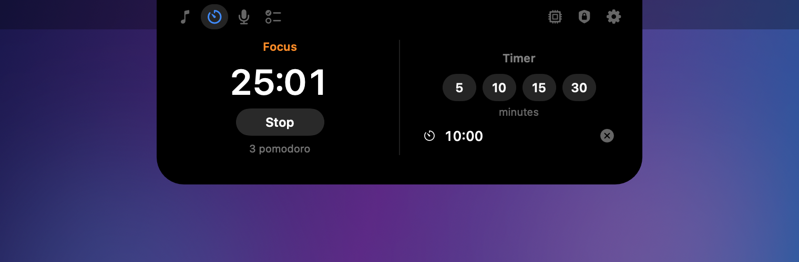
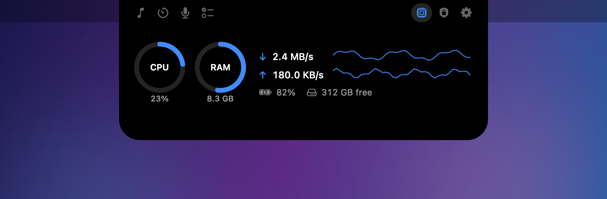
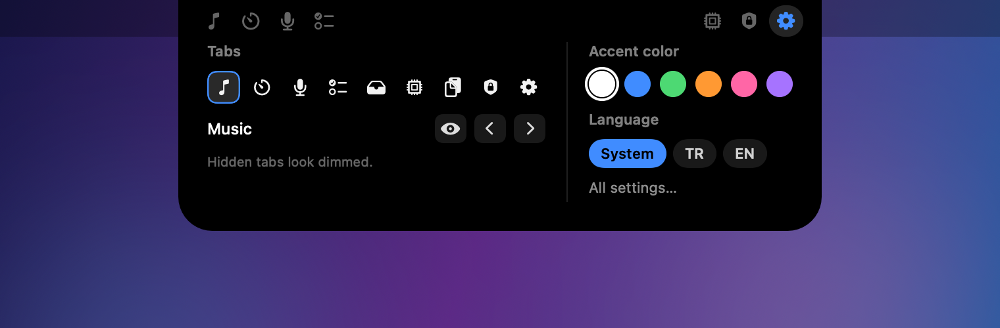

<div align="center">



# Perch

**Your notch, put to work.**

A tiny, native macOS app that turns the MacBook notch into a music player, timer, to-do list, voice notepad, file shelf and system monitor, plus **Away Guard**: a privacy screen that covers your display when you walk away and dissolves the moment you're back.


**English** · [Türkçe](README.tr.md)



</div>

---

## 🛡️ Away Guard: your screen steps aside when you do `beta`

Working in a café, an open office or a shared flat? Walk away from your Mac and Perch quietly covers your screen. Come back, and the cover **dissolves like steam from the edges inward**, with every app exactly where you left it. No camera, no password dance, no extra hardware.

<div align="center">

</div>

<div align="center">

</div>

**What makes it different**

- **It learns *your* normal.** Instead of a magic dBm number, Perch measures how strong your iPhone's or Apple Watch's signal is *at your desk* and reacts when it drops from that. It adapts to any device and any desk. You just pick **Low, Medium or High**.
- **It knows you're still there.** Typing, moving the mouse, watching a video or sitting in a call? Perch stays out of the way. It only steps in when you're genuinely gone.
- **Covers, doesn't lock.** A calm privacy screen with the time, a bird perched on a branch and live widgets (now playing with controls, running timers). Nothing underneath is touched, so you never lose what you were typing or have to sign back in.
- **Opens instantly.** The moment your device is back in range the screen is yours again. No waiting, no clicking.
- **Easy on the battery.** Scanning is duty-cycled in the background and fully off when the guard is off. In my measurements on an Apple-silicon MacBook Air it costs about **0.5% CPU** with protection on, and the privacy-screen animation only runs for about a second while it appears or disappears.
- **Private by design.** Passive Bluetooth signal-strength reading only: no camera, no microphone, no accounts, nothing leaves your Mac.
- **You stay in control.** Set or change a password under **Away Guard → Password**. If your Watch or phone dies or Bluetooth is off, enter that password on the right of the privacy screen. Touch ID or your Mac password also works. To hide the screen without a device, click **Hide now** or press `⌃⌥P`.

> **Honest limits (it's a beta).** The privacy screen is a cover. To use the macOS screen lock as well, enable the separate option in Settings and use your Mac password or Touch ID. Bluetooth signal strength is approximate: walls, pockets and body position change it. If your phone stays on the desk the Mac thinks you're nearby. Automatic detection works with Apple devices your Mac already recognises.

---

## Why Perch?

The notch is dead space. Perch gives it a job. Move your mouse to the notch and it opens; move away and it gets out of the way. No Dock icon, no windows, no subscription, no account.

Most notch apps focus on music and a file shelf. Perch adds the **time and planning tools** around them (Pomodoro, timers, to-dos, a **voice note that lands in Apple Notes**) and a notch-native **privacy guard**, in a single lightweight app.

## What makes Perch different

- **Away Guard.** A privacy screen that follows your iPhone or Watch, learns your desk and dissolves when you return.
- **Planning, not just playback.** Timers, Pomodoro and to-dos sit in the notch next to your music, so it becomes a small command center instead of a now-playing widget.
- **Voice → Apple Notes → iPhone.** Capture a thought with one global shortcut. It's transcribed on-device and shows up in Notes on every Apple device you own.
- **Private by design.** On-device speech recognition, a memory-only clipboard that skips password-manager copies, no accounts, no telemetry.
- **Free and honest.** No ads, no upgrade banners, no subscription. MIT licensed.
- **Tiny and dependency-free.** Pure Swift, about 4,000 lines, ~30 to 70 MB of RAM. Nothing to install but the app.
- **Yours to shape.** Hide and reorder tabs, choose an accent color, swipe between tabs, switch between English and Turkish.
- **Turkish first-class.** Full Turkish interface and on-device Turkish dictation, not an afterthought.

## Features

| | |
|---|---|
| 🛡️ **Away Guard** *(beta)* | Privacy screen that covers your display when your iPhone or Apple Watch leaves, with now-playing and timer widgets, and reveals instantly on return. Three sensitivity levels, learns your normal signal, never triggers while you use the Mac. |
| 🎵 **Music** | Spotify & Apple Music: artwork, progress, previous / play / next. While a song plays the closed notch grows to show the cover on one side and a live equalizer on the other. |
| ⏱ **Timers & Pomodoro** | Run several timers at once (5 / 10 / 15 / 30 min) plus a Pomodoro cycle with configurable focus and break lengths. The countdown lives *in* the notch; when time is up the panel pops open, plays a sound and sends a notification. |
| 🎙 **Voice notes** | Press `⌃⌥N` from anywhere, talk, press again. Speech is transcribed **on-device** and saved to **Apple Notes**, so it shows up on your iPhone through iCloud. The audio file stays on your Mac. |
| ✅ **To-do** | Add a task straight from the notch, tick it off. Saved between launches. |
| 📥 **File shelf + AirDrop** | Drag a file toward the notch: the panel opens on the shelf. Park files there to drag out later, or drop one on the AirDrop target to send it right away. |
| 📋 **Clipboard history** | Your last 20 copied texts; click one to copy it again. Memory-only, and copies flagged as secret by password managers are never stored. |
| 📊 **System** | Live CPU and RAM rings, network up/down speed with sparklines, battery and free disk space. Sampled only while the tab is open. |
| ⚙️ **Make it yours** | Hide and reorder tabs, pick an accent color, switch between English and Turkish, launch at login. Two-finger swipe over the notch to change tabs. |

Works on Macs **without** a notch too, as a small floating pill at the top of the screen.

<div align="center">
 

</div>

<sub>Images are rendered from the app's own interface code with sample data (`./Scripts/render_previews.sh`), so no personal information appears in them.</sub>

## Install

**From a release**

1. Download `Perch-x.y.z.dmg` from the [Releases](../../releases) page and drag **Perch** to *Applications*.
2. Perch is not notarized (no paid Apple Developer account), so on first launch macOS will warn you. Go to **System Settings → Privacy & Security → Open Anyway**, or run:
   ```bash
   xattr -cr /Applications/Perch.app
   ```
3. Move your mouse to the notch.

There is no Dock icon. Settings and Quit live in the menu bar icon (and in Perch's own Settings tab).

**From source** (Xcode 15+ or the Command Line Tools, Swift 5.9+)

```bash
git clone https://github.com/Tunayblg/perch.git
cd perch
./Scripts/build_app.sh     # → build/Perch.app
./Scripts/make_dmg.sh      # → build/Perch-1.1.0.dmg
open build/Perch.app
```

## Shortcuts

| Shortcut | Action |
|---|---|
| `⌃⌥N` | Start / stop a voice note |
| `⌃⌥P` | Show the privacy screen. When covered, focus the unlock panel if you set an Away Guard password, or reveal the screen directly if you haven't. |
| Two-finger swipe over the notch | Switch tabs |

## Permissions

Perch asks only for what each feature needs, the first time you use it:

| Permission | Used for |
|---|---|
| Automation → Spotify / Music | Reading and controlling playback |
| Automation → Notes | Saving voice notes |
| Microphone | Recording voice notes |
| Speech Recognition | On-device transcription |
| Bluetooth | Away Guard: reading your iPhone / Watch signal strength |
| Notifications | Timer and Pomodoro alerts |

## Privacy

- No accounts, no analytics, no telemetry.
- Speech is transcribed **on-device**; audio never leaves your Mac.
- Away Guard only reads Bluetooth signal strength. No camera, no microphone, no data collected.
- The only network request Perch makes is loading the album cover from Spotify's CDN.
- Clipboard history is kept in memory only and is gone when the app quits.

## Under the hood

Pure Swift, **zero third-party dependencies**. A few things that might be interesting to read:

- **Notch geometry:** the real notch size comes from `NSScreen.safeAreaInsets` and `auxiliaryTopLeftArea` / `auxiliaryTopRightArea`, so the shape lines up with the hardware on any model.
- **Overlay window:** a borderless, non-activating `NSPanel` above the menu bar on every Space. It can take keyboard input (for the to-do field) without ever stealing focus from your current app.
- **Away Guard signal:** CoreBluetooth scans advertising packets (no pairing, no connection) and keeps a slow-moving baseline of your device's RSSI *only while you're actively using the Mac*. "Away" means the short-term average fell a set number of dB below that baseline, so it adapts to every device and desk.
- **"Are you still there?":** system-wide idle time plus IOKit power assertions (video playback, calls) decide whether to stay out of the way.
- **Privacy screen:** a full-screen window at shielding level that swallows keyboard input, then hands focus back to the app you were in. The reveal is a blurred radial mask shrinking toward the centre; nothing animates while the screen is shown, so it costs no battery.
- **Battery:** timers only run when something needs them, scanning is duty-cycled, and the equalizer is a Core Animation layer driven by the render server instead of per-frame SwiftUI.
- **Hover & drag detection:** global `NSEvent` monitors open the panel on hover and, by inspecting the drag pasteboard, only when a *file* is being dragged (not a window or text).
- **Media bridge:** AppleScript against Spotify / Music, because the system-wide "now playing" API has been restricted since macOS 15.4.
- **Voice pipeline:** `AVAudioEngine` tap feeding both an AAC file writer and `SFSpeechRecognizer` with on-device recognition required; the result goes to Notes over AppleScript.
- **Global shortcuts:** Carbon `RegisterEventHotKey`, which needs no Accessibility permission.
- **System stats:** Mach `host_statistics` for CPU and memory, `getifaddrs` for network counters (with 32-bit wrap handling), IOKit power sources for the battery.

## Known limitations

- Music is read from Spotify and Apple Music only (no browser / YouTube yet). Apple Music artwork is not shown yet.
- After you reveal the screen with the Away Guard password or Mac authentication, automatic covering waits for a fresh nearby signal from your device.
- Voice notes add **text** to Notes; Notes' scripting interface does not accept audio attachments.
- The file shelf stores file *paths*; it does not copy files.
- Not notarized, so the first launch needs the *Open Anyway* step.

## Roadmap

Away Guard with motion detection (MacBook moved) · Alarm clock · Lower the music volume during Pomodoro breaks · Calendar (time to next meeting, one-click join) · Reminders · Habit streaks · Browser media support · Apple Music artwork · Quick "ask an AI" box

Details in [docs/PLAN.md](docs/PLAN.md) (Turkish) and the Away Guard research notes in [docs/AWAY_GUARD_RESEARCH.md](docs/AWAY_GUARD_RESEARCH.md).

## License

[MIT](LICENSE) © Tunayblg

Inspired by [boring.notch](https://github.com/TheBoredTeam/boring.notch), NotchNook and Atoll.
