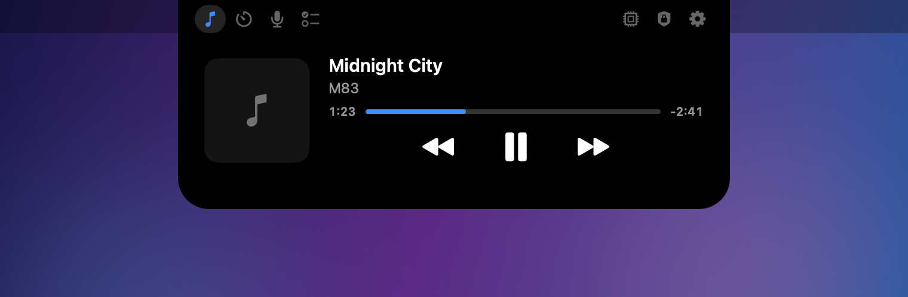
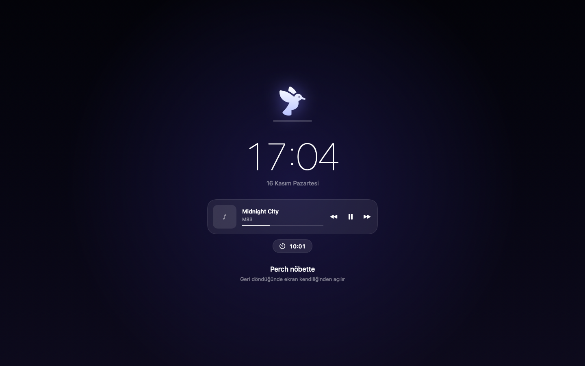
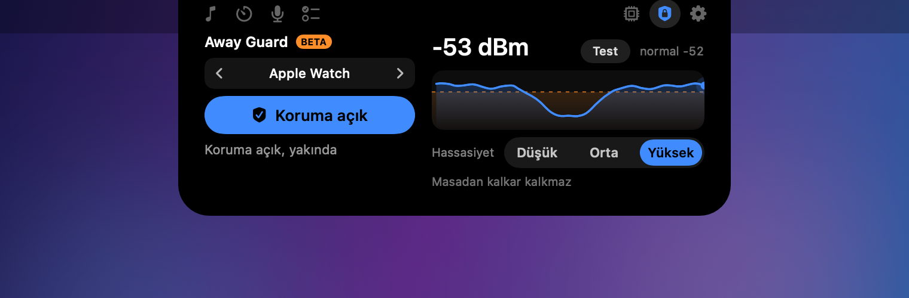
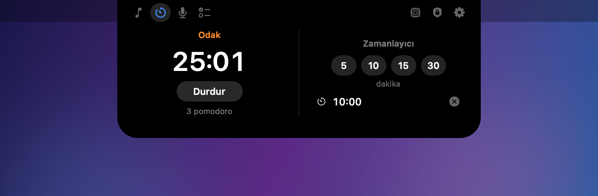
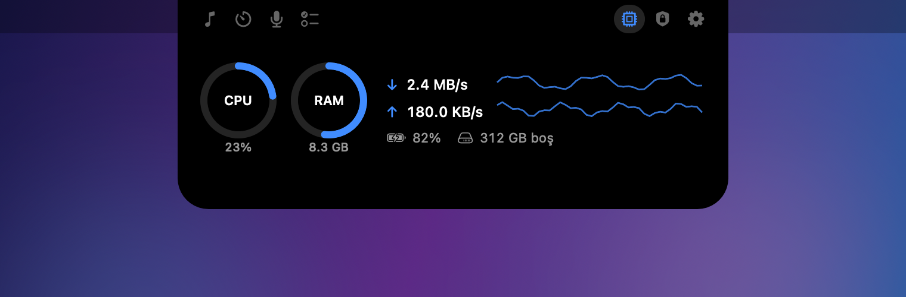
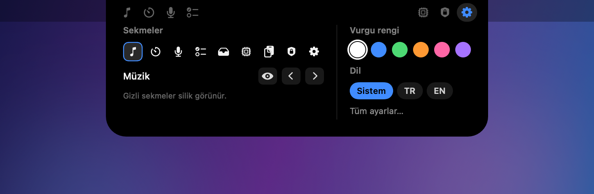

<div align="center">


# Perch

**Çentiğin artık iş görüyor.**

MacBook çentiğini müzik çalar, zamanlayıcı, yapılacaklar listesi, sesli not defteri, dosya rafı ve sistem monitörüne çeviren, küçük ve native bir macOS uygulaması. Üstüne **Away Guard**: yanından kalkınca ekranını örten, döndüğün anda buharlaşarak açılan bir gizlilik ekranı.


[English](README.md) · **Türkçe**



</div>

---

## 🛡️ Away Guard: sen kalkınca ekranın kenara çekilir `beta`

Kafede, açık ofiste ya da ortak evde mi çalışıyorsun? Mac'inin başından kalktığında Perch ekranını sessizce örter. Döndüğünde örtü **kenarlardan merkeze doğru buhar gibi dağılır** ve her uygulama bıraktığın yerde durur. Kamera yok, parola derdi yok, ek donanım yok.

<div align="center">

</div>

<div align="center">

</div>

**Neyi farklı yapıyor**

- **Senin "normalini" öğreniyor.** Sihirli bir dBm sayısı yerine Perch, iPhone'unun ya da Apple Watch'unun sinyalinin *masandayken* ne kadar güçlü olduğunu ölçer ve ondan düşünce harekete geçer. Her cihaza ve her masaya uyum sağlar. Sen sadece **Düşük, Orta ya da Yüksek** seçersin.
- **Hâlâ orada olduğunu biliyor.** Yazıyor, fareyi oynatıyor, video izliyor ya da görüşmedeysen Perch yolundan çekilir. Sadece gerçekten gittiğinde devreye girer.
- **Örter, kilitlemez.** Saat, dalda tünemiş bir kuş ve canlı widget'larla (kontrollü çalan müzik, çalışan zamanlayıcılar) sakin bir gizlilik ekranı. Altındaki hiçbir şeye dokunulmaz, yani yazdığını kaybetmez, yeniden oturum açmazsın.
- **Anında açılıyor.** Cihazın menzile girdiği an ekran yine senin. Bekleme yok, tıklama yok.
- **Pil dostu.** Arka planda tarama kısa aralıklarla yapılır, koruma kapalıyken hiç yapılmaz. Apple Silicon bir MacBook Air'de yaptığım ölçümlerde koruma açıkken yaklaşık **%0,5 CPU** harcıyor, gizlilik ekranı animasyonu da sadece belirirken ve kaybolurken yaklaşık bir saniye çalışıyor.
- **Tasarımdan gizli.** Yalnızca Bluetooth sinyal gücü okunur: kamera yok, mikrofon yok, hesap yok, Mac'inden hiçbir şey çıkmaz.
- **Kontrol sende.** Yedek kodun yoksa Away Guard, korumayı açmadan veya ekranı elle gizlemeden önce dört rakamlı bir PIN belirlemeni ister. Bu PIN gizlilik örtüsünü Bluetooth veya Mac parolan olmadan kaldırır. PIN’i **Away Guard → PIN** bölümünden değiştirebilirsin. Touch ID veya Mac parolası da kullanılabilir. Cihaz seçmeden ekranı gizlemek için **Elle gizle** düğmesine veya `⌃⌥P` kısayoluna bas.

> **Dürüst sınırlar (bu bir beta).** Gizlilik ekranı bir örtüdür. macOS ekran kilidini de kullanmak için Ayarlar’daki ayrı seçeneği etkinleştir ve Mac parolanı veya Touch ID’yi kullan. Bluetooth sinyal gücü yaklaşıktır: duvarlar, cepler ve vücut konumu etkiler. Telefonun masada kalırsa Mac seni yakında sanar. Otomatik algılama Mac'inin tanıdığı Apple cihazlarıyla çalışır.

---

## Neden Perch?

Çentik boş bir alan. Perch ona bir iş veriyor. Fareyi çentiğe götürünce açılıyor, çekince yolundan çekiliyor. Dock simgesi yok, pencere yok, abonelik yok, hesap yok.

Çoğu çentik uygulaması müzik ve dosya rafına odaklanıyor. Perch bunların yanına **zaman ve planlama araçlarını** (Pomodoro, zamanlayıcı, yapılacaklar, **Apple Notlar'a düşen sesli not**) ve çentiğe yerleşik bir **gizlilik koruması** ekliyor. Hepsi tek, hafif bir uygulamada.

## Perch'ü ayıran şeyler

- **Away Guard.** iPhone'unu ya da Watch'unu izleyen, masanı öğrenen ve döndüğünde dağılan bir gizlilik ekranı.
- **Sadece müzik değil, planlama.** Zamanlayıcı, Pomodoro ve yapılacaklar müziğin yanında çentikte durur; çentik "şu an çalan" kutusundan küçük bir komuta merkezine dönüşür.
- **Ses → Apple Notlar → iPhone.** Tek bir genel kısayolla bir düşünceyi yakala. Cihaz içinde yazıya çevrilir ve tüm Apple cihazlarındaki Notlar'da görünür.
- **Tasarımdan gizli.** Cihaz içi konuşma tanıma, parola yöneticisi kopyalarını atlayan ve yalnızca bellekte tutulan pano, hesap yok, telemetri yok.
- **Ücretsiz ve dürüst.** Reklam yok, "yükselt" afişi yok, abonelik yok. MIT lisanslı.
- **Küçük ve bağımlılıksız.** Saf Swift, yaklaşık 4.000 satır, ~30 ile 70 MB RAM. Uygulamadan başka kurulacak bir şey yok.
- **Sana göre şekillenir.** Sekmeleri gizle ve sırala, vurgu rengi seç, sekmeler arasında kaydır, Türkçe / İngilizce arasında geç.
- **Türkçe ilk sınıf.** Tam Türkçe arayüz ve cihaz içi Türkçe dikte, sonradan eklenmiş bir şey değil.

## Özellikler

| | |
|---|---|
| 🛡️ **Away Guard** *(beta)* | iPhone ya da Apple Watch uzaklaşınca ekranını, çalan müzik ve zamanlayıcı widget'larıyla birlikte örten, döndüğünde anında açan gizlilik ekranı. Üç hassasiyet seviyesi, normal sinyalini öğrenir, Mac'i kullanırken asla devreye girmez. |
| 🎵 **Müzik** | Spotify ve Apple Music: kapak, ilerleme, geri / oynat / ileri. Şarkı çalarken kapalı çentik iki yana uzar: bir yanda kapak, diğer yanda canlı ses çubukları. |
| ⏱ **Zamanlayıcı ve Pomodoro** | Aynı anda birden fazla zamanlayıcı (5 / 10 / 15 / 30 dk) ve süreleri ayarlanabilen Pomodoro döngüsü. Geri sayım çentiğin *içinde* görünür; süre dolunca panel kendiliğinden açılır, ses çalar, bildirim gelir. |
| 🎙 **Sesli not** | Her yerden `⌃⌥N`'e bas, konuş, tekrar bas. Konuşma **cihaz içinde** yazıya çevrilir ve **Apple Notlar'a** kaydedilir; iCloud ile iPhone'unda da görünür. Ses dosyası Mac'inde kalır. |
| ✅ **Yapılacaklar** | Çentikten hızlıca görev ekle, tik at. Uygulamayı kapatsan da kalır. |
| 📥 **Dosya rafı + AirDrop** | Bir dosyayı çentiğe doğru sürükle: panel raf sekmesinde açılır. Dosyayı rafta beklet, sonra başka yere sürükle ya da AirDrop kutusuna bırakıp hemen gönder. |
| 📋 **Pano geçmişi** | Son 20 kopyalanan metin; birine tıkla, tekrar kopyalansın. Sadece bellekte tutulur, parola yöneticilerinin gizli işaretlediği kopyalar hiç kaydedilmez. |
| 📊 **Sistem** | Canlı CPU ve RAM halkaları, mini grafikli ağ indirme/yükleme hızı, pil ve boş disk alanı. Yalnızca sekme açıkken ölçülür. |
| ⚙️ **Sana göre** | Sekmeleri gizle ve sırala, vurgu rengi seç, Türkçe / İngilizce arasında geç, oturum açılınca başlat. Çentiğin üstünde iki parmakla kaydırarak sekme değiştir. |

Çentiği **olmayan** Mac'lerde de çalışır, ekranın üstünde küçük bir yüzen kapsül olarak.

<div align="center">
 

</div>

<sub>Görüntüler uygulamanın kendi arayüz kodundan örnek verilerle üretilmiştir (`./Scripts/render_previews.sh`), bu yüzden içlerinde kişisel bilgi yoktur.</sub>

## Kurulum

**Sürümden**

1. [Releases](../../releases) sayfasından `Perch-x.y.z.dmg` dosyasını indir, **Perch**'ü *Uygulamalar*'a sürükle.
2. Perch noter onaylı değil (ücretli Apple Developer hesabı yok), bu yüzden ilk açılışta macOS uyarı verir. **Sistem Ayarları → Gizlilik ve Güvenlik → Yine de Aç** ya da şu komut:
   ```bash
   xattr -cr /Applications/Perch.app
   ```
3. Fareyi çentiğe götür.

Dock simgesi yoktur. Ayarlar ve Çıkış menü çubuğundaki simgede (ve Perch'ün kendi Ayarlar sekmesinde).

**Kaynaktan** (Xcode 15+ ya da Command Line Tools, Swift 5.9+)

```bash
git clone https://github.com/Tunayblg/perch.git
cd perch
./Scripts/build_app.sh     # → build/Perch.app
./Scripts/make_dmg.sh      # → build/Perch-1.1.0.dmg
open build/Perch.app
```

## Kısayollar

| Kısayol | Ne yapar |
|---|---|
| `⌃⌥N` | Sesli notu başlat / durdur |
| `⌃⌥P` | Gizlilik ekranını aç. Örtü açıksa, PIN veya şifre belirlediysen açma alanını öne getirir. Aksi hâlde örtüyü kaldırır. |
| Çentiğin üstünde iki parmakla kaydır | Sekme değiştir |

## İzinler

Perch, her özellik için yalnızca gereken izni, o özelliği ilk kullandığında ister:

| İzin | Ne için |
|---|---|
| Otomasyon → Spotify / Music | Çalan şarkıyı okumak ve kontrol etmek |
| Otomasyon → Notlar | Sesli notu kaydetmek |
| Mikrofon | Sesli not kaydı |
| Konuşma Tanıma | Cihaz içi yazıya çevirme |
| Bluetooth | Away Guard: iPhone / Watch sinyal gücünü okumak |
| Bildirimler | Zamanlayıcı ve Pomodoro uyarıları |

## Gizlilik

- Hesap yok, analitik yok, telemetri yok.
- Konuşma **cihaz içinde** yazıya çevrilir; ses Mac'inden çıkmaz.
- Away Guard yalnızca Bluetooth sinyal gücünü okur. Kamera yok, mikrofon yok, veri toplanmaz.
- Perch'ün yaptığı tek ağ isteği, albüm kapağını Spotify'ın sunucusundan yüklemek.
- Pano geçmişi yalnızca bellekte tutulur, uygulama kapanınca silinir.

## Kaputun altında

Saf Swift, **sıfır üçüncü taraf bağımlılık**. Okumaya değer birkaç nokta:

- **Çentik geometrisi:** Gerçek çentik boyutu `NSScreen.safeAreaInsets` ve `auxiliaryTopLeftArea` / `auxiliaryTopRightArea` ile okunur, şekil her modelde donanımla hizalanır.
- **Üst pencere:** Menü çubuğunun üstünde, her masaüstünde duran kenarlıksız, aktifleşmeyen bir `NSPanel`. Klavye girişi alabilir (yapılacaklar kutusu için) ama o an kullandığın uygulamanın odağını çalmaz.
- **Away Guard sinyali:** CoreBluetooth yayın paketlerini tarar (eşleşme yok, bağlantı yok) ve cihazının RSSI'ının yavaş hareket eden bir taban değerini *yalnızca sen Mac'i aktif kullanırken* tutar. "Uzakta", kısa vadeli ortalamanın bu tabanın belirli bir dB altına düşmesi demektir; bu sayede her cihaza ve masaya uyum sağlar.
- **"Hâlâ orada mısın?":** Sistem genelindeki boşta kalma süresi ile IOKit güç tutma kayıtları (video oynatma, görüşmeler) devreye girip girmemeye karar verir.
- **Gizlilik ekranı:** Koruma seviyesinde tam ekran pencere; klavye girdisini yutar, sonra odağı bulunduğun uygulamaya geri verir. Açılış, merkeze doğru küçülen bulanık bir radyal maskedir; ekran gösterilirken hiçbir şey animasyonlanmaz, yani pil harcamaz.
- **Pil:** Zamanlayıcılar yalnızca bir şeye ihtiyaç olduğunda çalışır, tarama aralıklıdır, ses çubukları kare kare SwiftUI yerine çizim sunucusunun yürüttüğü bir Core Animation katmanıdır.
- **Fare ve sürükleme algısı:** Genel `NSEvent` izleyicileri paneli üzerine gelince açar; sürükleme panosuna bakarak yalnızca bir *dosya* sürüklenirken açılır (pencere ya da metin sürüklemede açılmaz).
- **Medya köprüsü:** Spotify / Music'e AppleScript; çünkü sistem geneli "şu an çalıyor" API'si macOS 15.4'ten beri kısıtlı.
- **Ses hattı:** `AVAudioEngine` tap'i hem AAC dosyasına yazar hem de cihaz içi tanıma zorunlu `SFSpeechRecognizer`'a verir; sonuç AppleScript ile Notlar'a gider.
- **Genel kısayollar:** Erişilebilirlik izni gerektirmeyen Carbon `RegisterEventHotKey`.
- **Sistem verisi:** CPU ve bellek için Mach `host_statistics`, ağ sayaçları için `getifaddrs` (32 bit taşma korumalı), pil için IOKit.

## Bilinen sınırlar

- Müzik yalnızca Spotify ve Apple Music'ten okunur (tarayıcı / YouTube henüz yok). Apple Music kapağı henüz gösterilmiyor.
- Örtüyü Away Guard PIN’iyle veya Mac kimlik doğrulamasıyla kaldırdığında otomatik gizleme, cihazından yeni bir yakınlık sinyali gelene kadar bekler.
- Sesli not Notlar'a **metin** ekler; Notlar'ın betik arayüzü ses eki kabul etmez.
- Raf dosyaların *yolunu* tutar, dosyaları kopyalamaz.
- Noter onaylı değil, ilk açılışta *Yine de Aç* adımı gerekir.

## Yol haritası

Away Guard'a hareket algısı (MacBook taşındı mı) · Saatli alarm · Pomodoro molasında müziği kısma · Takvim (sıradaki toplantıya kalan süre, tek tıkla katıl) · Hatırlatıcılar · Alışkanlık takibi · Tarayıcı müzikleri · Apple Music kapağı · Hızlı "yapay zekâya sor" kutusu

Ayrıntı: [docs/PLAN.md](docs/PLAN.md) ve Away Guard araştırma notları: [docs/AWAY_GUARD_RESEARCH.md](docs/AWAY_GUARD_RESEARCH.md).

## Lisans

[MIT](LICENSE) © Tunayblg

İlham: [boring.notch](https://github.com/TheBoredTeam/boring.notch), NotchNook ve Atoll.
