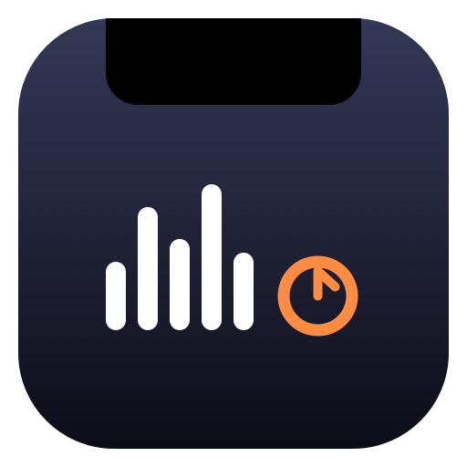

<div align="center">



# Perch

**Çentiğin artık iş görüyor.**

MacBook çentiğini müzik çalar, zamanlayıcı, yapılacaklar listesi, sesli not defteri, dosya rafı ve sistem monitörüne çeviren, küçük ve native bir macOS uygulaması. Hepsi tek bir fare hareketi uzağında.


[English](README.md) · **Türkçe**

</div>

<!-- Demo GIF'i çekince buraya ekle:    -->

---

## Neden Perch?

Çentik boş bir alan. Perch ona bir iş veriyor. Fareyi çentiğe götürünce açılıyor, çekince yolundan çekiliyor. Dock simgesi yok, pencere yok, abonelik yok, hesap yok.

Çoğu çentik uygulaması müzik ve dosya rafına odaklanıyor. Perch bunların yanına **zaman ve planlama araçlarını** ekliyor: Pomodoro, zamanlayıcı, yapılacaklar ve **Apple Notlar'a düşen sesli not**. Hepsi tek, hafif (~60 MB RAM) bir uygulamada.

## Perch'ü ayıran şeyler

- **Sadece müzik değil, planlama.** Zamanlayıcı, Pomodoro ve yapılacaklar müziğin yanında çentikte durur; çentik "şu an çalan" kutusundan küçük bir komuta merkezine dönüşür.
- **Ses → Apple Notlar → iPhone.** Tek bir genel kısayolla bir düşünceyi yakala. Cihaz içinde yazıya çevrilir ve tüm Apple cihazlarındaki Notlar'da görünür.
- **Tasarımdan gizli.** Cihaz içi konuşma tanıma, parola yöneticisi kopyalarını atlayan ve yalnızca bellekte tutulan pano, hesap yok, telemetri yok.
- **Ücretsiz ve dürüst.** Reklam yok, "yükselt" afişi yok, abonelik yok. MIT lisanslı.
- **Küçük ve bağımlılıksız.** Yaklaşık 2.600 satır Swift, ~60 MB RAM. Uygulamadan başka kurulacak bir şey yok.
- **Sana göre şekillenir.** Sekmeleri gizle ve sırala, vurgu rengi seç, sekmeler arasında kaydır, Türkçe / İngilizce arasında geç.
- **Türkçe ilk sınıf.** Tam Türkçe arayüz ve cihaz içi Türkçe dikte, sonradan eklenmiş bir şey değil.

## Özellikler

| | |
|---|---|
| 🎵 **Müzik** | Spotify ve Apple Music: kapak, ilerleme, geri / oynat / ileri. Şarkı çalarken kapalı çentik iki yana uzar: bir yanda kapak, diğer yanda canlı ses çubukları. |
| ⏱ **Zamanlayıcı ve Pomodoro** | Aynı anda birden fazla zamanlayıcı (5 / 10 / 15 / 30 dk) ve süreleri ayarlanabilen Pomodoro döngüsü. Geri sayım çentiğin *içinde* görünür; süre dolunca panel kendiliğinden açılır, ses çalar, bildirim gelir. |
| 🎙 **Sesli not** | Her yerden `⌃⌥N`'e bas, konuş, tekrar bas. Konuşma **cihaz içinde** yazıya çevrilir ve **Apple Notlar'a** kaydedilir; iCloud ile iPhone'unda da görünür. Ses dosyası Mac'inde kalır. |
| ✅ **Yapılacaklar** | Çentikten hızlıca görev ekle, tik at. Uygulamayı kapatsan da kalır. |
| 📥 **Dosya rafı + AirDrop** | Bir dosyayı çentiğe doğru sürükle: panel raf sekmesinde açılır. Dosyayı rafta beklet, sonra başka yere sürükle ya da AirDrop kutusuna bırakıp hemen gönder. |
| 📋 **Pano geçmişi** | Son 20 kopyalanan metin; birine tıkla, tekrar kopyalansın. Sadece bellekte tutulur, parola yöneticilerinin gizli işaretlediği kopyalar hiç kaydedilmez. |
| 📊 **Sistem** | Canlı CPU ve RAM halkaları, mini grafikli ağ indirme/yükleme hızı, pil ve boş disk alanı. Yalnızca sekme açıkken ölçülür. |
| ⚙️ **Sana göre** | Sekmeleri gizle ve sırala, vurgu rengi seç, Türkçe / İngilizce arasında geç, oturum açılınca başlat. Çentiğin üstünde iki parmakla kaydırarak sekme değiştir. |

Çentiği **olmayan** Mac'lerde de çalışır, ekranın üstünde küçük bir yüzen kapsül olarak.

## Kurulum

**Sürümden**

1. [Releases](../../releases) sayfasından `Perch-x.y.z.dmg` dosyasını indir, **Perch**'ü *Uygulamalar*'a sürükle.
2. Perch noter onaylı değil (ücretli Apple Developer hesabı yok), bu yüzden ilk açılışta macOS uyarı verir. **Sistem Ayarları → Gizlilik ve Güvenlik → Yine de Aç** ya da şu komut:
   ```bash
   xattr -cr /Applications/Perch.app
   ```
3. Fareyi çentiğe götür.

Dock simgesi yoktur. Ayarlar ve Çıkış menü çubuğundaki simgede (ve Perch'ün kendi Ayarlar sekmesinde).

**Kaynaktan** (Xcode 15+ ya da Command Line Tools, Swift 5.9+)

```bash
git clone https://github.com/Tunayblg/perch.git
cd perch
./Scripts/build_app.sh     # → build/Perch.app
./Scripts/make_dmg.sh      # → build/Perch-1.0.0.dmg
open build/Perch.app
```

## İzinler

Perch, her özellik için yalnızca gereken izni, o özelliği ilk kullandığında ister:

| İzin | Ne için |
|---|---|
| Otomasyon → Spotify / Music | Çalan şarkıyı okumak ve kontrol etmek |
| Otomasyon → Notlar | Sesli notu kaydetmek |
| Mikrofon | Sesli not kaydı |
| Konuşma Tanıma | Cihaz içi yazıya çevirme |
| Bildirimler | Zamanlayıcı ve Pomodoro uyarıları |

## Gizlilik

- Hesap yok, analitik yok, telemetri yok.
- Konuşma **cihaz içinde** yazıya çevrilir; ses Mac'inden çıkmaz.
- Perch'ün yaptığı tek ağ isteği, albüm kapağını Spotify'ın sunucusundan yüklemek.
- Pano geçmişi yalnızca bellekte tutulur, uygulama kapanınca silinir.

## Kaputun altında

Saf Swift, **sıfır üçüncü taraf bağımlılık**, yaklaşık 2.600 satır. Okumaya değer birkaç nokta:

- **Çentik geometrisi:** Gerçek çentik boyutu `NSScreen.safeAreaInsets` ve `auxiliaryTopLeftArea` / `auxiliaryTopRightArea` ile okunur, şekil her modelde donanımla hizalanır.
- **Üst pencere:** Menü çubuğunun üstünde, her masaüstünde duran kenarlıksız, aktifleşmeyen bir `NSPanel`. Klavye girişi alabilir (yapılacaklar kutusu için) ama o an kullandığın uygulamanın odağını çalmaz.
- **Fare ve sürükleme algısı:** Genel `NSEvent` izleyicileri paneli üzerine gelince açar; sürükleme panosuna bakarak yalnızca bir *dosya* sürüklenirken açılır (pencere ya da metin sürüklemede açılmaz).
- **Sekme kaydırma:** Kaydırma tekeri evreleri tek bir ayrık hareket olarak toplanır, yön sistemin doğal kaydırma ayarına uyar.
- **Medya köprüsü:** Spotify / Music'e AppleScript; çünkü sistem geneli "şu an çalıyor" API'si macOS 15.4'ten beri kısıtlı.
- **Ses hattı:** `AVAudioEngine` tap'i hem AAC dosyasına yazar hem de cihaz içi tanıma zorunlu `SFSpeechRecognizer`'a verir; sonuç AppleScript ile Notlar'a gider.
- **Genel kısayol:** Erişilebilirlik izni gerektirmeyen Carbon `RegisterEventHotKey`.
- **Sistem verisi:** CPU ve bellek için Mach `host_statistics`, ağ sayaçları için `getifaddrs` (32 bit taşma korumalı), pil için IOKit.
- **Akıcı arayüz:** Görünümler SwiftUI, animasyonlu özel bir çentik `Shape`'i, yönlü sekme geçişleri.

## Bilinen sınırlar

- Müzik yalnızca Spotify ve Apple Music'ten okunur (tarayıcı / YouTube henüz yok). Apple Music kapağı henüz gösterilmiyor.
- Sesli not Notlar'a **metin** ekler; Notlar'ın betik arayüzü ses eki kabul etmez.
- Raf dosyaların *yolunu* tutar, dosyaları kopyalamaz.
- Noter onaylı değil, ilk açılışta *Yine de Aç* adımı gerekir.

## Yol haritası

**Away Guard (planlı, isteğe bağlı beta):** kafede çalışırken kısa süreliğine kalktın mı? iPhone'un ya da Apple Watch'un menzilden çıkınca Perch ekranını gizler: kilitler, bulanıklaştırır ya da bildirim önizlemelerini saklar. Kamera kullanmayan bir gizlilik yardımcısı, varsayılan olarak kapalı.

Ayrıca planlı: Saatli alarm · Pomodoro molasında müziği kısma · Takvim (sıradaki toplantıya kalan süre, tek tıkla katıl) · Hatırlatıcılar · Alışkanlık takibi · Tarayıcı müzikleri · Apple Music kapağı · Hızlı "yapay zekâya sor" kutusu

Ayrıntı: [docs/PLAN.md](docs/PLAN.md)

## Lisans

[MIT](LICENSE) © Tunayblg

İlham: [boring.notch](https://github.com/TheBoredTeam/boring.notch), NotchNook ve Atoll.
